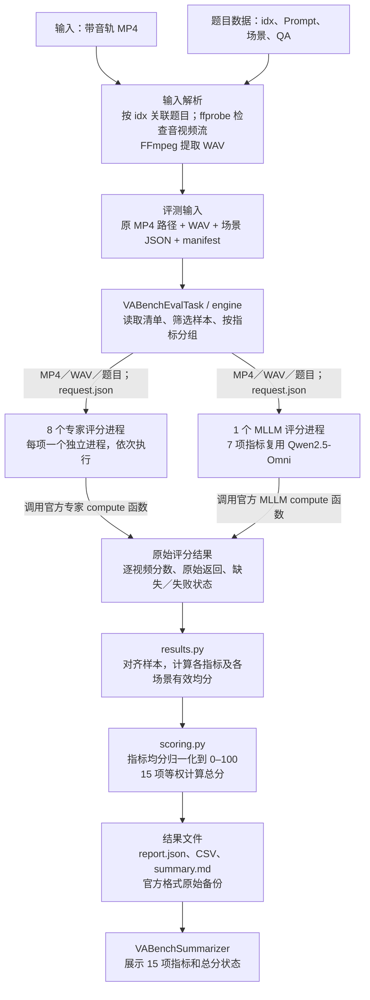
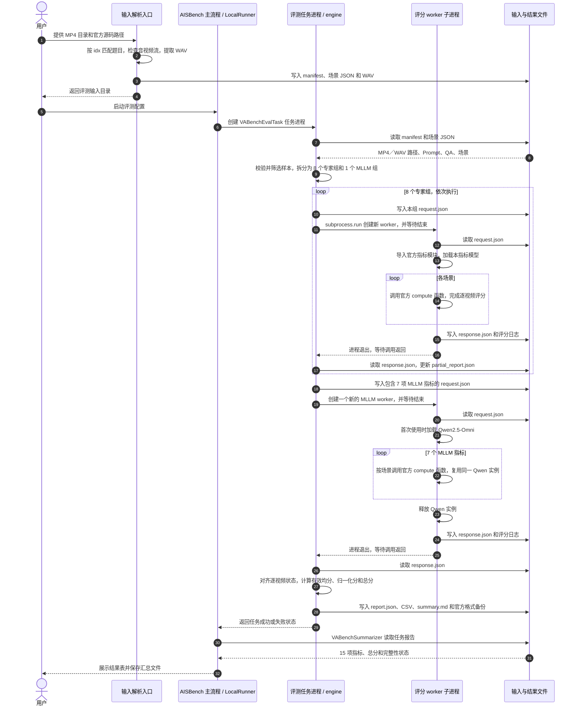

# Aisbench 接入 VABench T2AV 评测方案设计

## 1. 需求背景与方案范围

### 1.1 需求背景

MiniMax H3 等模型可根据文本生成带音轨的视频。评测这类模型需要同时考察画面和音频质量、生成内容与提示词的一致性，以及声音事件与画面动作的同步情况。原始需求提出将这些维度纳入 AISBench 的统一评测流程，以便横向比较不同模型，并用相同题目和评分口径做版本回归。VABench 提供题目、元数据和评分实现，本项目据此接入文本生成音视频（T2AV）场景。 [音视频同出精度测评需求](<原始需求/【AISBench】支持音视频同出模型精度测评.md>) · [VABench 接入需求](<原始需求/【AISBench】支持VABench音视频生成评测能力.md>)

完整集的评分成本较高，开发验证和模型适配需要小规模、可复用的输入集。项目采用 778 条能与官方 mapping 精确匹配的 T2AV 题目作为标准集，并固化其中 78 条作为约 10% 的快速评测集。子集覆盖全部 24 个类别，与标准集共用题目元数据和评分实现，适合在扩展到完整集之前验证评测链路。 [Mini Benchmark 需求](<原始需求/【AISBench】构建VABench Mini Benchmark快速评测集.md>)

### 1.2 方案范围

| 事项 | 本期设计 |
| --- | --- |
| 输入 | 被测模型已生成的带音轨 MP4，按官方 `idx` 关联题目、场景、Prompt 和 QA 元数据 |
| 执行 | AISBench 在 GPU 上调度外部 VABench 评分实现，覆盖 8 个专家指标和 7 个 MLLM 指标 |
| 输出 | 保存逐视频原始分及失败状态，按模型、场景和指标汇总，展示原始均分、归一化分、有效覆盖率和总分 |
| 验收 | 用同一批输入分别执行原生 VABench 与 AISBench 评测，按第 5 节比较逐指标原始均分并核对样本状态 |

原始需求覆盖生成与评分，并包含 GPU/NPU 验收目标。本期交付边界从已有 MP4 开始，优先在 H200 上完成评分接入与官方对齐。生成 API 接入和昇腾 A3/NPU 验证安排在后续阶段。MiniMax H3 属于被测生成模型，Qwen2.5-Omni 在评分子进程内承担 MLLM 指标的评判。 [原始场景与验收需求](<原始需求/测评工具支持音视同出模型的测评能力.md>)

整体调用链为：**MP4 解析 → 评测输入清单 → 任务进程 → 评分子进程 → 原始结果 → 指标汇总 → 分数展示**。

### 1.3 代码目录与职责

以下目录以 AISBench 仓库 `benchmark/` 为根，对应当前提交 `dd40900`。外部 `VABench/` 通过评分配置传入，由 worker 在运行时导入。

```text
benchmark/
├── ais_bench/
│   ├── benchmark/
│   │   ├── datasets/vabench/
│   │   │   ├── __init__.py          # 导出 VABenchDataset
│   │   │   └── dataset.py           # 将 manifest 记录加载为 Dataset
│   │   ├── tasks/vabench/
│   │   │   ├── __init__.py          # 轻量任务包入口
│   │   │   ├── eval.py              # AISBench 任务入口与状态回传
│   │   │   ├── engine.py            # 分组、启动 worker、收集响应
│   │   │   ├── worker.py            # 调用官方 compute 函数
│   │   │   └── resources.py         # 资源路径、预检与来源指纹
│   │   ├── summarizers/vabench/
│   │   │   ├── __init__.py          # 按需导出框架汇总器
│   │   │   ├── results.py           # 对齐结果、统计与导出
│   │   │   ├── scoring.py           # 归一化、补零和总分状态
│   │   │   └── summarizer.py        # AISBench 汇总表
│   │   └── utils/vabench/
│   │       ├── __init__.py          # 专家与 MLLM 指标清单
│   │       ├── data.py              # 输入关联、解析、校验与筛选
│   │       └── protocol.json        # 固定题目范围及数据文件指纹
│   ├── configs/vabench_examples/
│   │   ├── eval_vabench_custom.py   # 主命令使用的运行配置
│   │   └── mini10pct.json           # 固定 78 题的 idx 和类别
│   └── tools/vabench/
│       ├── __init__.py              # 工具包入口
│       ├── cli.py                   # catalog、prepare、doctor、compare-official
│       ├── environment.py           # 安装编排与环境检查
│       ├── official_prepare.py      # 组织原生评测所需的输入目录
│       └── official_compare.py      # 对照原生输出与 AISBench 原始备份
└── tests/UT/vabench/                # 数据、调度、评分和对照的回归测试
```

| 边界 | 调用关系与数据交接 |
| --- | --- |
| 输入与框架 | `cli.py` 调用 `data.py` 生成 manifest 和场景 JSON。`VABenchDataset` 提供框架注册和独立加载能力，实际评测由 `VABenchEvalTask` 直接读取准备好的文件 |
| 任务与评分 | `eval.py` 将框架配置交给 `engine.py`，后者为每组评分生成请求并启动 `worker.py`。`resources.py` 提供模型路径和预检，worker 在自己的进程中调用官方评分函数 |
| 评分与展示 | `results.py` 将逐样本返回值对齐到输入清单，`scoring.py` 计算固定口径的展示分，`summarizer.py` 读取任务报告并生成框架结果表 |
| 独立官方对照 | `official_prepare.py` 为原生 `evaluate.py` 组织输入，`official_compare.py` 比较两个流程写出的原始结果。`environment.py` 在评测前负责安装和检查评分环境 |

安装器逐函数说明、依赖清单和测试文件用途见 [源码文件职责与环境安装流程详解](VABench_源码文件职责与环境安装流程详解_20261108.md)。具体运行步骤见 [VABench 快速上手](../benchmark/docs/source_zh_cn/extended_benchmark/lmm_generate/vabench.md)。

## 2. 数据流图



图中的两条评分支路表示不同类型的评分组。默认先依次执行 8 个专家组，再执行 1 个 MLLM 组，共 9 个评分子进程。评分函数内部负责各模型需要的视频解码、抽帧、音频预处理和推理。

## 3. 进程调用时序图

下面展示 AISBench 主命令的执行路径。`engine` 与 Task 在同一评测任务进程内；外部 VABench 评分函数在 worker 内执行。



任务进程入口为 `ais_bench.benchmark.tasks.vabench.eval`，评分子进程入口为 `ais_bench.benchmark.tasks.vabench.worker`。父进程通过 `request.json` 传递输入，通过 `response.json` 收集结果；`subprocess.run` 会等待当前评分组退出后再启动下一组。图中重复使用的 worker 泳道代表先后创建的不同进程实例。

7 个 MLLM 指标在同一个 worker 中顺序执行，Qwen 模型由官方运行时缓存复用，完成该组后释放。专家组的模型随各自评分进程退出而释放。仅运行部分指标时，只创建所请求指标对应的评分组。

单个评分组失败时，engine 将错误写入结果，继续收集其余组；报告写出后再判断任务状态。任务进度按已完成评分组数计算，有效覆盖率按成功评分的视频数计算。

## 4. 从原始分到最终展示

### 4.1 计算顺序

1. **逐视频原始分**：保存官方返回值，区分有效评分、缺失、省略和执行失败。
2. **指标原始均分**：只对该指标的有效视频分数求算术平均；跨场景按视频等权。
3. **指标归一化分**：对原始均分应用固定公式，并限制在 0–100。
4. **总分**：15 项归一化分等权平均，分母固定为 15。

| 指标 | 原始均分 m 的归一化公式 |
| --- | --- |
| DNSMOS、NISQA、5 个 third 指标 | `(m−1)/4×100` |
| AudioBox | `(m+1.75)/9×100` |
| ViCLIP、CLAP、ImageBind | `(m+1)/2×100` |
| Desync | `(1−m/2)×100`，原始偏移越小越好 |
| LSA | `m/10×100`，10 为固定展示锚点 |
| 2 个 QA 指标 | `m×100` |

### 4.2 展示内容

| 展示层级 | 内容 | 主要结果文件 |
| --- | --- | --- |
| 逐视频 | 原始返回、有效分、缺失或错误状态 | `report.json`、`samples.csv`、官方格式备份 |
| 指标与场景 | 原始均分、0–100 分、有效数／应评数、失败数、缺失数、覆盖率 | `metrics.csv`、`scenes.csv` |
| 总分 | 15 项等权分数、有效指标数、补零指标、正式／预览状态 | `total.csv`、`summary.md` |
| AISBench 汇总表 | 15 项指标行和总分行 | 框架 summary 目录中的 Markdown／CSV |

请求全部 15 项时，没有有效均分的指标按 0 计入总分，原始均分仍留空，并展示“预览总分／不完整”。例如其余 14 项各 60 分、LSA 缺失，总分为 `(14×60+0)/15=56`。15 项均完整时展示当前评测范围的正式总分；只请求部分指标时不生成 15 项总分。

总分状态与任务状态分别判断：全无有效分时保留 0 分预览，任务返回失败；其他指标缺失或执行异常也返回失败。仅无后端错误的 LSA 官方省略可在其他请求项有有效分时允许任务完成，其总分仍标为预览。

## 5. 与官方结果的比较

使用原生 VABench `evaluate.py` 的结果，与 AISBench 保存的官方格式原始备份比较同一批视频的各项原始均分：

- 相同输入、源码、权重、参数及样本状态是比较前提。
- 官方均分绝对值大于 `1e-6` 时，要求相对误差严格 `<1%`；否则要求绝对误差 `≤1e-6`。
- `compare-official` 分别报告均分验收与逐题数值诊断；空指标、缺失集合不一致和已知错误兜底不能通过。
- 归一化分及 15 项总分属于 AISBench 展示规则；官方对齐以原始指标为准。

## 6. 测试用例与验收

### 6.1 自动化回归用例

在 AISBench 仓库根目录运行以下命令。用例通过临时媒体文件、模拟评分函数或构造的结果验证 AISBench 接入逻辑。真实媒体用例依赖 FFmpeg 和 FFprobe，核对固定题库的用例依赖本地官方源码。执行时检查跳过项及原因。

```bash
python3 -m pytest tests/UT/vabench -q -rs
```

| 编号 | 测试输入或操作 | 预期结果 | 对应测试 |
| --- | --- | --- | --- |
| UT-01 | 使用固定版本的官方题库和 mapping；分别按标准集、固定 78 题和已有 MP4 选题 | 标准集得到 778 个唯一题目；固定 78 题均在标准集内并覆盖 24 类；自定义输入按 MP4 文件名匹配官方 `idx`，未知或重复文件名报错 | [题库与精确匹配](../benchmark/tests/UT/vabench/test_catalog_offline.py) · [固定子集与输入流程](../benchmark/tests/UT/vabench/test_pipeline.py) |
| UT-02 | 准备一条带音轨的 MP4，再分别验证缺视频、无音轨及准备后文件被修改的情况 | 正常输入产生 `manifest.json`、场景 JSON 和 WAV；异常输入在准备或校验阶段报错 | [媒体准备与哈希校验](../benchmark/tests/UT/vabench/test_pipeline.py) |
| UT-03 | 检查全量指标分组，用两个模拟 MLLM 指标启动实际子进程，并模拟一组评分失败 | 15 项分为 8 个专家组和 1 个 MLLM 组；两个 MLLM 指标共用一个 worker；失败组错误落盘，其他组继续执行 | [分组与进程通信](../benchmark/tests/UT/vabench/test_pipeline.py) · [失败报告](../benchmark/tests/UT/vabench/test_runtime_paths.py) |
| UT-04 | 构造两个场景的 NISQA 结果，场景一两条有效分均为 1，场景二一条有效分为 5；另测归一化锚点、反向指标及失败样本 | 跨场景原始均分为 `7/3`，归一化分约为 33.33；保留场景均分；失败样本留空并计入覆盖率缺口；Desync 的 0 秒映射为 100 分 | [均分、归一化与失败处理](../benchmark/tests/UT/vabench/test_scoring.py) |
| UT-05 | 构造 15 项归一化分均为 50，再分别模拟 LSA 全部被官方省略、LSA 后端报错、全部指标缺分及只请求单项 | 全部有效时正式总分为 50；仅 LSA 无有效分时，其原始均分留空、总分补零后展示预览 46.67；LSA 后端报错使任务失败；全无有效分保留 0 分预览且任务失败；单项运行的总分为空 | [总分与任务状态](../benchmark/tests/UT/vabench/test_scoring.py) · [AISBench 状态回传](../benchmark/tests/UT/vabench/test_aisbench.py) |
| UT-06 | 读取一次任务报告并生成框架汇总，同时检查导出文件 | 汇总表展示 15 项指标和 1 行总分；CSV 保留原始均分、归一化分及补零指标；官方格式备份保留原始结果 | [框架表格与结果导出](../benchmark/tests/UT/vabench/test_scoring.py) |
| UT-07 | 构造两份原生格式报告，覆盖路径前缀不同、误差恰好 1%、官方均分接近 0、缺样本及双方出现相同错误兜底 | 按类别、指标及样本对齐；路径前缀差异不影响匹配；相对误差等于 1% 时失败，近零时按绝对误差验收；样本缺口不一致和已知错误兜底均失败 | [官方结果比较](../benchmark/tests/UT/vabench/test_official_compare.py) |

### 6.2 H200 端到端用例

以下用例在 H200 上使用真实 MP4、官方模型和固定权重。操作步骤见 [VABench 快速上手](../benchmark/docs/source_zh_cn/extended_benchmark/lmm_generate/vabench.md)。

| 编号 | 测试输入与操作 | 验收检查 |
| --- | --- | --- |
| GPU-01 单条冒烟 | 用带音轨的 `kitten curled up meowing.mp4` 执行 `prepare --subset custom`，在 AISBench 中请求全部 15 项 | 清单中只有 `easy_bioacoustics` 的这道题；检查评分日志、逐指标结果和框架汇总表。若官方省略 LSA，核对省略数、覆盖率和预览总分 |
| GPU-02 固定子集 | 按仓库固定清单准备全部 78 条 MP4，执行 AISBench 评测 | 题目 ID 与清单一致，输入覆盖 24 类，报告 `subset_size=78`；核对 15 项有效数、失败数、覆盖率和总分状态 |
| GPU-03 标准集 | 准备全部 778 条 MP4，用 `prepare --subset standard` 后执行 AISBench 评测 | 准备阶段发现缺视频即报错；输入齐备时报告范围为 `standard`，包含 778 条输入及逐视频、逐场景和逐指标结果 |
| GPU-04 官方对齐 | 对同一批 MP4，使用相同官方源码、权重、评分配置和音频预处理分别运行原生 VABench 与 AISBench，再执行 `compare-official` | 按第 5 节逐项验收 15 个原始均分，核对两侧样本和失败／省略集合。某项双方均无有效分时，该项无法验收，需补充有适用样本的对照输入 |

验收时保存输入 `manifest.json`、运行配置、AISBench `report.json` 和框架汇总表、两侧原始评分输出及比较报告。单条冒烟验证评测链路，78 题和 778 题结果分别记录其实际输入范围。[历史 GPU 操作记录](../过程/10.txt)用于复现原生流程；GPU 对齐结论以对应批次的比较报告为准。
